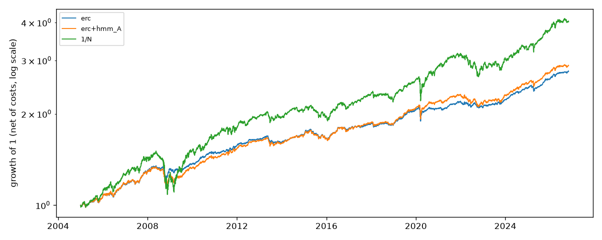

# Regime detection and portfolio construction

> Does a regime layer built from strictly filtered (real-time) probabilities improve out-of-sample, after-cost allocation, against the same optimizer without it and against 1/N?

A walk-forward research system on 12 ETFs:

- **Regimes:** a strictly filtered Gaussian HMM and Bayesian online change-point detection.
- **Allocation:** four covariance estimators and four optimizers.
- **Benchmark:** each variant is compared with 1/N through the same rebalancer and cost model.
- **Test:** the Ledoit–Wolf (2008) Sharpe-difference test.

Every number below is generated from `reports/tables/` by `regport report`.

## Results

<!-- regport:headline:start -->
**No strategy beats 1/N at the 5% level after Holm's adjustment: none of the 16 strategies has a significantly higher net Sharpe ratio than 1/N.**

The preregistered headline, `erc+hmm_A`, earned a net Sharpe ratio of 0.68 (95% interval 0.24 to 1.12) against 0.57 for 1/N; the difference, +0.11, has a bootstrap p-value of 0.31 (1.00 after Holm). The smallest difference this sample could detect with 80% power is about 0.31.

Selected rows (the headline, each optimizer without regimes, and 1/N); all 16 strategies are in reports/oos_vs_1n.md.

| strategy | sharpe | delta_sharpe_vs_1n | p_bootstrap | max_drawdown | annual_turnover | cost_drag_bps |
|---|---|---|---|---|---|---|
| erc | 0.70 | 0.13 | 0.35 | -0.10 | 0.55 | 1.53 |
| erc+hmm_A | 0.68 | 0.11 | 0.31 | -0.13 | 0.47 | 1.13 |
| hrp | 0.61 | 0.04 | 0.84 | -0.09 | 1.96 | 4.87 |
| 1/N | 0.57 | 0.00 | - | -0.28 | 0.22 | 0.51 |
| mv_turnover | 0.51 | -0.06 | 0.76 | -0.21 | 5.27 | 11.19 |
| min_variance | 0.45 | -0.12 | 0.55 | -0.07 | 1.70 | 4.00 |
<!-- regport:headline:end -->

### What the regime layer adds (ablation, net of costs)

Each regime arm is compared with the same optimizer without regimes, using the paired Ledoit–Wolf bootstrap test.

<!-- regport:ablation:start -->
Of 12 regime arms, 0 change the net Sharpe ratio significantly at 5% (unadjusted). The largest gain is `mv_turnover+hmm_A`, +0.11 (p = 0.46).

| optimizer | regime | delta_sharpe | p_bootstrap | delta_turnover | delta_max_drawdown |
|---|---|---|---|---|---|
| erc | bocpd | 0.03 | 0.21 | 0.19 | 0.00 |
| erc | hmm_A | -0.02 | 0.70 | -0.08 | -0.03 |
| erc | hmm_B | -0.01 | 0.84 | 0.10 | -0.01 |
| hrp | bocpd | 0.03 | 0.28 | 0.36 | -0.00 |
| hrp | hmm_A | -0.01 | 0.87 | -0.44 | -0.01 |
| hrp | hmm_B | -0.04 | 0.56 | -0.33 | -0.02 |
| min_variance | bocpd | -0.01 | 0.77 | 0.32 | 0.00 |
| min_variance | hmm_A | 0.10 | 0.20 | -0.72 | -0.02 |
| min_variance | hmm_B | 0.10 | 0.16 | -0.33 | -0.01 |
| mv_turnover | bocpd | -0.01 | 0.54 | 0.13 | 0.00 |
| mv_turnover | hmm_A | 0.11 | 0.46 | 0.93 | -0.05 |
| mv_turnover | hmm_B | 0.08 | 0.57 | 2.43 | -0.03 |
<!-- regport:ablation:end -->

### Stress windows (fixed in advance, never tuned)

<!-- regport:stress:start -->
| window | strategy | max_drawdown | recovery |
|---|---|---|---|
| covid_2020 | min_variance | -0.070 | 934 days (2023-12-01) |
| covid_2020 | erc+hmm_A | -0.101 | 74 days (2020-07-02) |
| covid_2020 | 1/N | -0.168 | 75 days (2020-07-06) |
| gfc_2008 | min_variance | -0.056 | 49 days (2008-12-19) |
| gfc_2008 | erc+hmm_A | -0.131 | 319 days (2010-03-02) |
| gfc_2008 | 1/N | -0.281 | 248 days (2009-11-16) |
| rates_2022 | min_variance | -0.054 | 294 days (2023-12-01) |
| rates_2022 | erc+hmm_A | -0.086 | 335 days (2024-02-01) |
| rates_2022 | 1/N | -0.158 | 410 days (2024-05-15) |
<!-- regport:stress:end -->

### Robustness

<!-- regport:robustness:start -->
**Break-even one-way cost against 1/N** (uniform cost grid):

| optimizer | regime | break_even_cost |
|---|---|---|
| min_variance | none | below 1/N at 0 bps |
| min_variance | hmm_A | below 1/N at 0 bps |
| erc | none | above 1/N up to 25 bps |
| erc | hmm_A | above 1/N up to 25 bps |
| hrp | none | 12.1 bps |
| hrp | hmm_A | 11.7 bps |
| mv_turnover | none | below 1/N at 0 bps |
| mv_turnover | hmm_A | 7.1 bps |

- **Common start (2008-04-11):** `erc+hmm_A` 0.62 vs 1/N 0.50 (HAC p = 0.31).
- **Kenneth French ind10:** best `mv_turnover` 0.62, 1/N 0.55; 0 strategies differ from 1/N at 5% (HAC).
- **Kenneth French ind49:** best `1/N` 0.56, 1/N 0.56; 0 strategies differ from 1/N at 5% (HAC).
- **ALFRED point in time vs revised (feature set B, ERC):** net Sharpe 0.691 vs 0.695; stress-probability mean absolute difference 0.33, most likely state agreeing on 43% of days.
<!-- regport:robustness:end -->

### How many configurations were tried

<!-- regport:trials:start -->
The trial log holds 243 backtests (0 failed) over 81 distinct configurations, every run included. The best strategy, `erc+bocpd` (net Sharpe 0.73), has a deflated Sharpe ratio of 1.00 against the best of 243 zero-skill trials (expected maximum 0.44); that is a test of skill against zero, not against 1/N.
<!-- regport:trials:end -->

Reports: [1/N](reports/oos_vs_1n.md) · [ablation](reports/ablation.md) · [stress](reports/stress.md) · [robustness](reports/robustness.md) · [covariance](reports/cov_eval.md) · [regimes](reports/regimes.md) · [scaling](reports/scaling.md) · [data quality](reports/data_quality.md).



## Hypothesis

Published regime-switching backtests often leak in four ways:

- smoothed HMM probabilities, which condition on the whole sample;
- one fit on all the data;
- tuning on the crisis they later survive;
- weak benchmarks.

This project removes each leak. It then asks whether a regime layer beats the optimizer alone, and whether anything beats 1/N, after costs. The headline (ERC with the HMM layer, tested against 1/N) was preregistered in [docs/preregistration.md](docs/preregistration.md) before any real-data backtest ran.

## Data
- **Universe:** 12 ETFs across equities (SPY, EFA, EEM, VNQ), rates (IEF, TLT, TIP), credit (LQD, HYG), commodities (GLD, DBC) and FX (UUP).
- **Prices:** daily total-return prices from Sharadar SFP. A Stooq snapshot serves as a cross-check only.
- **Staggered entry:** an ETF enters every strategy, 1/N included, after 252 valid returns. No proxy history is spliced in.
- **Out of sample:** from 2005-01-03 to the last complete month.
- **Macro inputs:** FRED series lag one business day. ALFRED vintages give point-in-time macro values.

<!-- regport:data:start -->
The panel has 12 ETFs. SPY's Sharadar history starts on 1997-12-31; all 12 are eligible from 2008-04-11 (the last to enter is HYG).
<!-- regport:data:end -->

[reports/data_quality.md](reports/data_quality.md) checks distributions, availability lags, eligibility and byte-identical rebuilds. It also lists the owner-ruled exceptions:

- SPY's history starts in 1998.
- Some days where Sharadar and Stooq disagree, mostly distributions Stooq leaves unadjusted.

## Method
**Covariance.** Sample, EWMA, Ledoit–Wolf and OAS, scored by the bias statistic and QLIKE on non-overlapping 1-, 5- and 21-day windows. The estimator was chosen on 2005–2014 windows only, by a rule committed before the run.

<!-- regport:risk:start -->
The estimator chosen on 2005–2014 windows (D-12) is `ewma`. Over the full out-of-sample period at a 21-day horizon its bias statistic is 0.976 for 1/N and 0.979 for the median random portfolio (261 windows; 95% band 0.914 to 1.086). For its own minimum-variance portfolio it is 1.136: like every estimator here, it understates the risk of the portfolio it was optimized on.
<!-- regport:risk:end -->

**Regimes.**

- **HMM:** fitted by Baum–Welch (hmmlearn `fit` only) on the SPY return and the daily BAA10Y change. Refits run every 21 days on an expanding window. Probabilities come from my own log-space forward filter. Label switching is handled by canonical order plus Hungarian matching on symmetric KL divergence.
- **BOCPD:** Adams & MacKay with a Normal–Gamma prior.
- **Hyperparameters:** chosen on data before 2005. The hazard was later reselected under the validation constraint by owner ruling, with the original choice kept on record.
- **How they are used:** the HMM sets a mixture covariance with forward state weights; BOCPD switches to a fast EWMA after a likely change point.

<!-- regport:regime:start -->
K = 4 states on feature set A, 285 walk-forward refits (first fit ending 2003-01-31), 18 label switches. 1243 early days use the French market proxy for SPY. BOCPD (hazard 1/500) flags a short run on 5.9% of out-of-sample days. With the same parameters, the smoother crosses 50% stress probability earlier than the real-time filter by (days): gfc_2008 2, covid_2020 0, rates_2022 3.
<!-- regport:regime:end -->

**Allocation.**

- **Optimizers:** min-variance and mean–variance with a turnover penalty (cvxpy, cap 0.40); ERC (my own Newton solver); HRP (my own); 1/N.
- **Rebalancing:** monthly decisions, trading only when a weight drifts more than 2 points. Execution follows the next day.
- **Costs:** 1–5 bps one-way.
- **Tests:** Ledoit–Wolf bootstrap and HAC with Holm's adjustment; a deflated Sharpe ratio over the trial log.

Formulas are in [docs/methodology.md](docs/methodology.md).

## What failed or was changed along the way
- **BOCPD hazard:** the preregistered choice failed the spec's false-alarm bound. It was reselected by owner ruling, and the deviation is recorded in [docs/preregistration.md](docs/preregistration.md).
- **Bugs caught by tests:** an integer prior broke BOCPD's running means, and the first label-switch count was inflated.
- **ALFRED comparison:** the first version compared state indices across independently labelled runs. It was replaced by label-invariant measures.
- **Filtered vs smoothed:** with daily data, the smoother leads the real-time filter by only a few days at regime turns. Mostly it holds the stress state through dips ([figure](reports/figures/filtered_vs_smoothed.png)).
- **No significant effect:** the regime layer improved no optimizer significantly, and on the 49 industries HRP didn't beat min-variance on out-of-sample volatility.

## Limitations

- **Selection bias (DQ-13):** the 12 ETFs were picked knowing they all survived.
- **Low power:** the sample can't resolve small Sharpe differences; the minimum detectable difference is reported with each test.
- **Costs:** proportional only, with no market impact.
- **Proxy:** before 1998, the French market return stands in for SPY in the regime features.
- **Not run:** the AQR robustness run (a Could item that needs a monthly engine path), proxy splicing and futures.

## Scaling to 500 assets

<!-- regport:scaling:start -->
At N = 500 assets on a 504-day window (N/T = 0.99) the condition number is 2e+07 for the sample covariance, 6.2e+03 for Ledoit-Wolf and 4.4e+02 for a 10-factor PCA model. On the 49 industries, out-of-sample volatility was 12.2% for min-variance and 15.2% for HRP.
<!-- regport:scaling:end -->

## How to reproduce

```bash
uv sync
cp .env.example .env            # add FRED_API_KEY and SHARADAR_API_KEY
uv run regport fetch all        # raw data with a SHA-256 manifest; nothing goes into git
uv run regport reproduce --check
```

`reproduce` reruns everything from the raw data, logging each backtest as a trial: data checks, regimes (recomputed), cov-eval, the grid, evaluation, stress, robustness, scaling and reports. With `--check` it fails unless every table matches `reports/manifest.json`; timing tables are recorded, not compared. `regport report` rebuilds the reports from saved outputs without new backtests.

Also:

```bash
uv run regport backtest --optimizer hrp --regime bocpd
uv run pytest tests/unit/test_no_lookahead.py -v
```

## FAQ
**Why does 1/N so often beat mean–variance?** Estimation error in expected returns swamps the gain from optimizing (DeMiguel, Garlappi and Uppal 2009). Here mean–variance has the most turnover and cost drag, and the break-even cost table shows how fast costs erase its edge.

**How do you handle HMM label switching?** States are put in canonical order by equity-return variance, then matched to the previous refit by the Hungarian algorithm on symmetric KL divergence. When the matching overrules the canonical order it wins, and the switch is logged ([src/regport/regime/labels.py](src/regport/regime/labels.py)).

**How would this scale to 500 assets?** The sample covariance becomes nearly singular as N approaches T. Shrinkage or a statistical factor model fixes the conditioning, and the optimizers stay fast ([reports/scaling.md](reports/scaling.md)). Estimation error and turnover bind, not compute.

**How do you prove regime probabilities don't look ahead?** For 50 random dates, the later data are replaced with noise or removed, and the filter, the walk-forward HMM (refits included) and BOCPD must be unchanged up to that date within 1e-12. hmmlearn's smoothed posteriors fail the same test, and an AST scan bans the smoothing calls ([tests/unit/test_no_lookahead.py](tests/unit/test_no_lookahead.py)).

**Which covariance estimator, chosen how?** By lowest QLIKE on 2005–2014 windows, under a rule committed before the evaluation ([reports/cov_eval.md](reports/cov_eval.md)).

**What does the regime layer add after costs?** Nothing significant (see the ablation table).

**Why Ledoit–Wolf instead of Jobson–Korkie?** Jobson–Korkie assumes iid normal returns. Ledoit–Wolf stays valid under fat tails and autocorrelation. With iid normal data the two standard errors agree within 2%.

**How many configurations, and what does that do to the best one?** Every run, failed runs included, is in [results/trial_log.csv](results/trial_log.csv). The best strategy's edge over 1/N is insignificant even before deflation.

**Why can HRP beat min-variance out of sample?** HRP never inverts the covariance matrix, so it amplifies estimation error less. On the 49 industries here it didn't beat min-variance on volatility, so treat it as an empirical question.

## Requirements

- [x] A multi-asset universe of 10–20 liquid ETFs or futures proxies across equities, rates, credit, commodities and FX. (FR-01, FR-07; AC-W-05 with SPY's 1998 start as a documented exception)
- [x] Regime models using filtered (real-time) probabilities only: Gaussian HMM and Bayesian online change-point detection. (FR-11 to FR-16; [reports/regimes.md](reports/regimes.md))
- [x] Covariance estimators (sample, EWMA, Ledoit–Wolf, OAS) evaluated on out-of-sample risk forecasts. (FR-09, FR-10; [reports/cov_eval.md](reports/cov_eval.md))
- [x] Optimizers: minimum variance, equal risk contribution, HRP (López de Prado 2016), and constrained mean–variance with a turnover penalty. (FR-17 to FR-20, AC-W-08)
- [x] A 1/N benchmark (DeMiguel, Garlappi and Uppal 2009) and cost-aware rebalancing. (FR-21 to FR-24, AC-W-10)

## Success criteria

### Works (correct and reproducible)

- [x] A unit test shows regime probabilities at time t never use data after t (no smoothed-state leakage). (AC-W-01: tests/unit/test_no_lookahead.py)
- [x] ERC portfolios have equal risk contributions within 1e-6, and constraints always hold. (AC-W-02: property tests and a check at every rebalance; [constraint audit](reports/tables/constraint_audit.csv))
- [x] The ex-ante vs ex-post volatility bias statistic is close to 1 for your chosen estimator. (AC-W-03, [reports/cov_eval.md](reports/cov_eval.md))

### Impresses hirers

- [x] An out-of-sample comparison against 1/N with a proper Sharpe-difference test (Ledoit and Wolf 2008), reported honestly even if 1/N wins. (AC-H-01: [reports/oos_vs_1n.md](reports/oos_vs_1n.md))
- [x] An ablation showing what the regime layer adds over the optimizer alone, net of turnover. (AC-H-02: [reports/ablation.md](reports/ablation.md))
- [x] Stress tests through 2008, 2020 and 2022 with drawdown and recovery statistics. (AC-H-03: [reports/stress.md](reports/stress.md))

## Credits and notices

- **Prices:** Sharadar Fund Prices (SFP) under the owner's licence, aggregates only. Stooq is a cross-check.
- **FRED:** this product uses the FRED® API but is not endorsed or certified by the Federal Reserve Bank of St. Louis. Series: DTB3, T10Y3M; BAA10Y (Moody's; model input only); VIXCLS (CBOE Volatility Index: VIX, Chicago Board Options Exchange, retrieved from FRED); ALFRED vintages of UNRATE, PAYEMS, CPIAUCSL and INDPRO.
- **Kenneth R. French Data Library** (Tuck School of Business at Dartmouth): FF3 factors and 10/49 industries, daily. Files are not redistributed.
- **AQR** permits publishing aggregate results; its robustness run isn't in this version.

Decisions and their reasons are in [docs/decisions.md](docs/decisions.md). Code is MIT-licensed ([LICENSE](LICENSE)); data are not redistributed.
