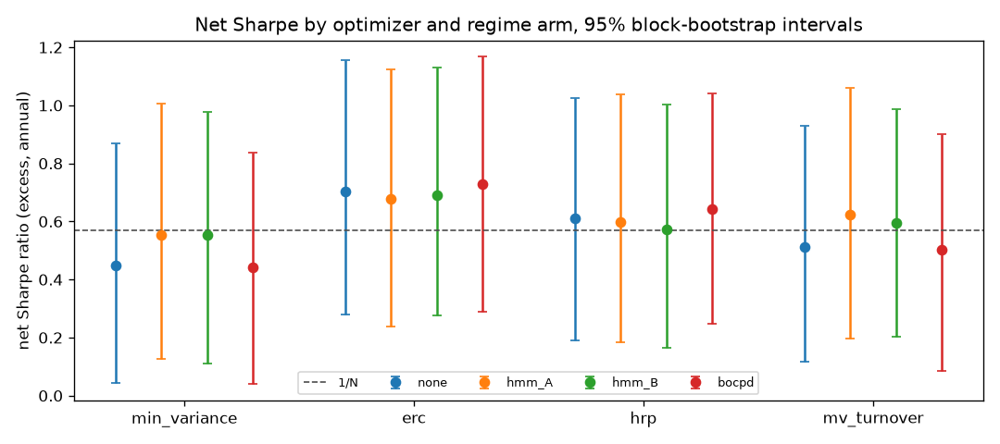

# Ablation: what the regime layer adds

Generated by `regport evaluate`; do not edit by hand.

Each regime arm against the same optimizer without a regime layer, net of costs. Differences are arm minus base; p-values are the Ledoit-Wolf bootstrap and HAC tests of the paired Sharpe difference.

| optimizer | regime | delta_sharpe | p_bootstrap | p_hac | delta_ceq | delta_turnover | delta_cost_drag_bps | delta_max_drawdown |
|---|---|---|---|---|---|---|---|---|
| erc | bocpd | 0.027 | 0.211 | 0.210 | 0.001 | 0.194 | 0.522 | 0.003 |
| erc | hmm_A | -0.025 | 0.696 | 0.688 | 0.002 | -0.083 | -0.401 | -0.026 |
| erc | hmm_B | -0.011 | 0.835 | 0.833 | 0.003 | 0.098 | 0.126 | -0.012 |
| hrp | bocpd | 0.033 | 0.283 | 0.281 | 0.001 | 0.364 | 0.894 | -0.004 |
| hrp | hmm_A | -0.013 | 0.866 | 0.870 | 0.000 | -0.439 | -1.158 | -0.013 |
| hrp | hmm_B | -0.038 | 0.562 | 0.576 | -0.000 | -0.335 | -1.167 | -0.015 |
| min_variance | bocpd | -0.009 | 0.773 | 0.791 | -0.000 | 0.318 | 0.820 | 0.001 |
| min_variance | hmm_A | 0.105 | 0.196 | 0.190 | 0.005 | -0.717 | -1.679 | -0.021 |
| min_variance | hmm_B | 0.103 | 0.163 | 0.167 | 0.005 | -0.328 | -0.693 | -0.013 |
| mv_turnover | bocpd | -0.010 | 0.536 | 0.492 | -0.001 | 0.134 | 0.260 | 0.000 |
| mv_turnover | hmm_A | 0.110 | 0.456 | 0.444 | 0.013 | 0.931 | 2.245 | -0.054 |
| mv_turnover | hmm_B | 0.083 | 0.575 | 0.566 | 0.009 | 2.428 | 5.719 | -0.031 |

