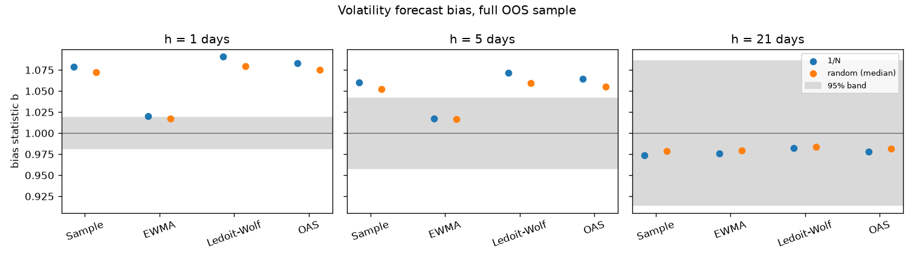

# Covariance estimators: out-of-sample risk forecasts

Generated by `regport cov-eval`; do not edit by hand.

- OOS period: 2005-01-03 to 2026-10-30. Non-overlapping windows of 1, 5, 21 trading days.
- Portfolios scored at each origin: 1/N, 100 random long-only Dirichlet(1) portfolios (the same for every estimator), and each estimator's own capped minimum-variance portfolio.
- Asset exclusions under DQ-04 (more than 5% null returns in the 504-day window): 1384 asset-origins. Min-variance solver failures: 0.

## Selection (D-12)

The rule fixed in `docs/decisions.md` before this evaluation: lowest mean QLIKE at h = 21 over 1/N and the random portfolios, on windows ending by 2014-12-31.

| estimator | n_windows | qlike_mean | b_equal_weight | b_random_median | min_variance_realized_vol |
|---|---|---|---|---|---|
| ewma | 119 | -6.2424 | 0.8898 | 0.9082 | 0.0483 |
| sample | 119 | -6.0301 | 0.9287 | 0.9363 | 0.0446 |
| oas | 119 | -6.0295 | 0.9321 | 0.9383 | 0.0446 |
| ledoit_wolf | 119 | -6.0284 | 0.9356 | 0.9397 | 0.0460 |

**Chosen estimator: `ewma`.**

## AC-W-03

For `ewma` at h = 21 over the full OOS: b = 0.976 for 1/N and 0.979 for the median random portfolio. The criterion is [0.90, 1.10] for both: **pass**.

## h = 1 days, full OOS

| estimator | n_windows | b_equal_weight | b_random_median | b_random_p05 | b_random_p95 | b_min_variance | band_lo95 | band_hi95 | qlike_mean | min_variance_realized_vol | min_variance_forecast_vol |
|---|---|---|---|---|---|---|---|---|---|---|---|
| ewma | 5491 | 1.020 | 1.018 | 1.008 | 1.029 | 1.061 | 0.981 | 1.019 | -9.554 | 0.036 | 0.031 |
| ledoit_wolf | 5491 | 1.091 | 1.079 | 1.067 | 1.094 | 1.030 | 0.981 | 1.019 | -9.340 | 0.038 | 0.036 |
| oas | 5491 | 1.083 | 1.075 | 1.063 | 1.090 | 1.071 | 0.981 | 1.019 | -9.343 | 0.038 | 0.034 |
| sample | 5491 | 1.079 | 1.072 | 1.060 | 1.087 | 1.099 | 0.981 | 1.019 | -9.344 | 0.038 | 0.033 |

## h = 5 days, full OOS

| estimator | n_windows | b_equal_weight | b_random_median | b_random_p05 | b_random_p95 | b_min_variance | band_lo95 | band_hi95 | qlike_mean | min_variance_realized_vol | min_variance_forecast_vol |
|---|---|---|---|---|---|---|---|---|---|---|---|
| ewma | 1098 | 1.017 | 1.017 | 0.989 | 1.040 | 1.096 | 0.958 | 1.042 | -7.906 | 0.038 | 0.032 |
| ledoit_wolf | 1098 | 1.072 | 1.059 | 1.036 | 1.085 | 1.042 | 0.958 | 1.042 | -7.705 | 0.039 | 0.036 |
| oas | 1098 | 1.065 | 1.055 | 1.033 | 1.080 | 1.074 | 0.958 | 1.042 | -7.707 | 0.038 | 0.034 |
| sample | 1098 | 1.060 | 1.052 | 1.029 | 1.077 | 1.099 | 0.958 | 1.042 | -7.708 | 0.038 | 0.033 |

## h = 21 days, full OOS

| estimator | n_windows | b_equal_weight | b_random_median | b_random_p05 | b_random_p95 | b_min_variance | band_lo95 | band_hi95 | qlike_mean | min_variance_realized_vol | min_variance_forecast_vol |
|---|---|---|---|---|---|---|---|---|---|---|---|
| ewma | 261 | 0.976 | 0.979 | 0.921 | 1.033 | 1.136 | 0.914 | 1.086 | -6.404 | 0.039 | 0.032 |
| ledoit_wolf | 261 | 0.983 | 0.984 | 0.935 | 1.032 | 1.052 | 0.914 | 1.086 | -6.224 | 0.038 | 0.036 |
| oas | 261 | 0.978 | 0.981 | 0.933 | 1.030 | 1.080 | 0.914 | 1.086 | -6.225 | 0.038 | 0.034 |
| sample | 261 | 0.974 | 0.978 | 0.930 | 1.027 | 1.116 | 0.914 | 1.086 | -6.226 | 0.038 | 0.033 |

## h = 1 days, second half (origins after 2014-12-31)

| estimator | n_windows | b_equal_weight | b_random_median | b_random_p05 | b_random_p95 | b_min_variance | band_lo95 | band_hi95 | qlike_mean | min_variance_realized_vol | min_variance_forecast_vol |
|---|---|---|---|---|---|---|---|---|---|---|---|
| ewma | 2974 | 1.029 | 1.027 | 1.009 | 1.044 | 1.068 | 0.975 | 1.025 | -9.715 | 0.030 | 0.028 |
| ledoit_wolf | 2974 | 1.109 | 1.100 | 1.079 | 1.120 | 1.051 | 0.975 | 1.025 | -9.514 | 0.032 | 0.032 |
| oas | 2974 | 1.100 | 1.094 | 1.073 | 1.114 | 1.098 | 0.975 | 1.025 | -9.518 | 0.032 | 0.030 |
| sample | 2974 | 1.094 | 1.090 | 1.069 | 1.110 | 1.130 | 0.975 | 1.025 | -9.519 | 0.032 | 0.029 |

## h = 5 days, second half (origins after 2014-12-31)

| estimator | n_windows | b_equal_weight | b_random_median | b_random_p05 | b_random_p95 | b_min_variance | band_lo95 | band_hi95 | qlike_mean | min_variance_realized_vol | min_variance_forecast_vol |
|---|---|---|---|---|---|---|---|---|---|---|---|
| ewma | 594 | 1.055 | 1.046 | 1.015 | 1.084 | 1.078 | 0.943 | 1.057 | -8.055 | 0.029 | 0.028 |
| ledoit_wolf | 594 | 1.136 | 1.113 | 1.073 | 1.159 | 1.028 | 0.943 | 1.057 | -7.872 | 0.031 | 0.032 |
| oas | 594 | 1.127 | 1.107 | 1.067 | 1.155 | 1.055 | 0.943 | 1.057 | -7.875 | 0.030 | 0.030 |
| sample | 594 | 1.121 | 1.103 | 1.063 | 1.151 | 1.082 | 0.943 | 1.057 | -7.876 | 0.030 | 0.029 |

## h = 21 days, second half (origins after 2014-12-31)

| estimator | n_windows | b_equal_weight | b_random_median | b_random_p05 | b_random_p95 | b_min_variance | band_lo95 | band_hi95 | qlike_mean | min_variance_realized_vol | min_variance_forecast_vol |
|---|---|---|---|---|---|---|---|---|---|---|---|
| ewma | 141 | 1.050 | 1.041 | 0.940 | 1.100 | 1.149 | 0.883 | 1.117 | -6.540 | 0.030 | 0.028 |
| ledoit_wolf | 141 | 1.027 | 1.022 | 0.953 | 1.077 | 1.079 | 0.883 | 1.117 | -6.385 | 0.031 | 0.032 |
| oas | 141 | 1.022 | 1.019 | 0.949 | 1.074 | 1.115 | 0.883 | 1.117 | -6.386 | 0.031 | 0.030 |
| sample | 141 | 1.017 | 1.016 | 0.946 | 1.070 | 1.162 | 0.883 | 1.117 | -6.388 | 0.031 | 0.029 |

## h = 1 days, selection half (windows ending by 2014-12-31)

| estimator | n_windows | b_equal_weight | b_random_median | b_random_p05 | b_random_p95 | b_min_variance | band_lo95 | band_hi95 | qlike_mean | min_variance_realized_vol | min_variance_forecast_vol |
|---|---|---|---|---|---|---|---|---|---|---|---|
| ewma | 2516 | 1.010 | 1.006 | 0.990 | 1.023 | 1.050 | 0.972 | 1.028 | -9.362 | 0.042 | 0.036 |
| ledoit_wolf | 2516 | 1.069 | 1.056 | 1.035 | 1.080 | 1.004 | 0.972 | 1.028 | -9.134 | 0.043 | 0.040 |
| oas | 2516 | 1.064 | 1.054 | 1.033 | 1.079 | 1.036 | 0.972 | 1.028 | -9.135 | 0.043 | 0.039 |
| sample | 2516 | 1.060 | 1.052 | 1.031 | 1.077 | 1.059 | 0.972 | 1.028 | -9.135 | 0.043 | 0.038 |

## h = 5 days, selection half (windows ending by 2014-12-31)

| estimator | n_windows | b_equal_weight | b_random_median | b_random_p05 | b_random_p95 | b_min_variance | band_lo95 | band_hi95 | qlike_mean | min_variance_realized_vol | min_variance_forecast_vol |
|---|---|---|---|---|---|---|---|---|---|---|---|
| ewma | 503 | 0.972 | 0.974 | 0.944 | 1.008 | 1.109 | 0.938 | 1.062 | -7.730 | 0.046 | 0.036 |
| ledoit_wolf | 503 | 0.992 | 0.991 | 0.953 | 1.030 | 1.055 | 0.938 | 1.062 | -7.507 | 0.046 | 0.040 |
| oas | 503 | 0.989 | 0.989 | 0.951 | 1.029 | 1.091 | 0.938 | 1.062 | -7.508 | 0.046 | 0.039 |
| sample | 503 | 0.985 | 0.987 | 0.948 | 1.027 | 1.114 | 0.938 | 1.062 | -7.508 | 0.046 | 0.038 |

## h = 21 days, selection half (windows ending by 2014-12-31)

| estimator | n_windows | b_equal_weight | b_random_median | b_random_p05 | b_random_p95 | b_min_variance | band_lo95 | band_hi95 | qlike_mean | min_variance_realized_vol | min_variance_forecast_vol |
|---|---|---|---|---|---|---|---|---|---|---|---|
| ewma | 119 | 0.890 | 0.908 | 0.842 | 0.978 | 1.122 | 0.873 | 1.127 | -6.242 | 0.048 | 0.036 |
| ledoit_wolf | 119 | 0.936 | 0.940 | 0.874 | 1.011 | 1.025 | 0.873 | 1.127 | -6.028 | 0.046 | 0.040 |
| oas | 119 | 0.932 | 0.938 | 0.872 | 1.012 | 1.043 | 0.873 | 1.127 | -6.030 | 0.045 | 0.039 |
| sample | 119 | 0.929 | 0.936 | 0.871 | 1.011 | 1.065 | 0.873 | 1.127 | -6.030 | 0.045 | 0.038 |

