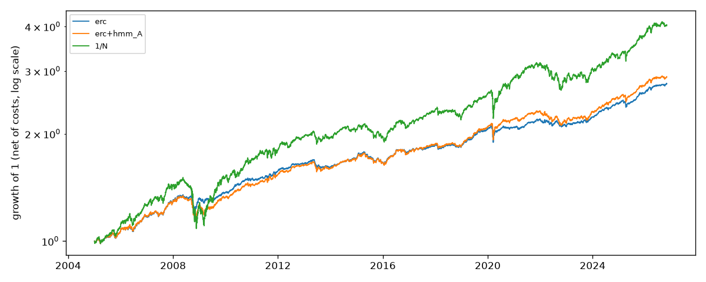

# Out-of-sample comparison with 1/N

Generated by `regport evaluate`; do not edit by hand.

**No strategy beats 1/N at the 5% level after Holm's adjustment: none of the 16 strategies has a significantly higher net Sharpe ratio than 1/N.**

- Period: 2005-01-03 to 2026-10-30, daily returns net of costs, excess of the risk-free rate. Sharpe ratios are annualized.
- Headline (preregistered): `erc+hmm_A`.
- p-values: Ledoit-Wolf (2008) studentized circular block bootstrap (5,000 resamples, block size calibrated per pair; headline test) and HAC (Parzen, VAR(1) prewhitening), two-sided, for the Sharpe difference against 1/N. Holm adjusts the bootstrap p-values across all strategies.
- Intervals: 95% percentile circular block bootstrap (block 10) of each Sharpe ratio.

| strategy | sharpe | sharpe_ci_lo | sharpe_ci_hi | delta_sharpe_vs_1n | p_bootstrap | p_hac | p_holm | ceq | annual_turnover | cost_drag_bps | max_drawdown |
|---|---|---|---|---|---|---|---|---|---|---|---|
| erc+bocpd | 0.729 | 0.288 | 1.168 | 0.161 | 0.260 | 0.293 | 1.000 | 0.030 | 0.748 | 2.049 | -0.102 |
| erc | 0.702 | 0.280 | 1.156 | 0.134 | 0.350 | 0.365 | 1.000 | 0.029 | 0.555 | 1.527 | -0.104 |
| erc+hmm_B | 0.691 | 0.275 | 1.131 | 0.122 | 0.307 | 0.319 | 1.000 | 0.032 | 0.652 | 1.653 | -0.117 |
| erc+hmm_A | 0.677 | 0.239 | 1.124 | 0.109 | 0.309 | 0.330 | 1.000 | 0.031 | 0.471 | 1.126 | -0.131 |
| hrp+bocpd | 0.643 | 0.246 | 1.042 | 0.075 | 0.721 | 0.719 | 1.000 | 0.026 | 2.324 | 5.766 | -0.094 |
| mv_turnover+hmm_A | 0.622 | 0.197 | 1.059 | 0.054 | 0.756 | 0.751 | 1.000 | 0.062 | 6.205 | 13.436 | -0.259 |
| hrp | 0.610 | 0.191 | 1.025 | 0.042 | 0.837 | 0.837 | 1.000 | 0.025 | 1.961 | 4.872 | -0.091 |
| hrp+hmm_A | 0.598 | 0.183 | 1.038 | 0.030 | 0.869 | 0.873 | 1.000 | 0.025 | 1.521 | 3.714 | -0.104 |
| mv_turnover+hmm_B | 0.595 | 0.205 | 0.988 | 0.027 | 0.891 | 0.895 | 1.000 | 0.059 | 7.703 | 16.910 | -0.236 |
| hrp+hmm_B | 0.573 | 0.164 | 1.004 | 0.005 | 0.980 | 0.981 | 1.000 | 0.025 | 1.626 | 3.705 | -0.106 |
| 1/N | 0.568 | 0.169 | 0.993 | 0.000 | - | - | - | 0.046 | 0.215 | 0.512 | -0.281 |
| min_variance+hmm_A | 0.555 | 0.126 | 1.005 | -0.013 | 0.941 | 0.943 | 1.000 | 0.020 | 0.986 | 2.316 | -0.090 |
| min_variance+hmm_B | 0.553 | 0.109 | 0.978 | -0.015 | 0.938 | 0.939 | 1.000 | 0.020 | 1.375 | 3.303 | -0.082 |
| mv_turnover | 0.512 | 0.116 | 0.929 | -0.056 | 0.756 | 0.764 | 1.000 | 0.050 | 5.275 | 11.191 | -0.205 |
| mv_turnover+bocpd | 0.501 | 0.085 | 0.900 | -0.067 | 0.723 | 0.721 | 1.000 | 0.049 | 5.409 | 11.451 | -0.205 |
| min_variance | 0.450 | 0.045 | 0.868 | -0.118 | 0.545 | 0.550 | 1.000 | 0.015 | 1.702 | 3.996 | -0.070 |
| min_variance+bocpd | 0.440 | 0.039 | 0.836 | -0.128 | 0.519 | 0.528 | 1.000 | 0.015 | 2.021 | 4.815 | -0.068 |

## Power

Minimum Sharpe difference detectable at 80% power and 5% two-sided, from each pair's HAC standard error (annualized):

| strategy | min_detectable_delta_80pct |
|---|---|
| erc+bocpd | 0.429 |
| erc | 0.414 |
| erc+hmm_B | 0.344 |
| erc+hmm_A | 0.313 |
| hrp+bocpd | 0.586 |
| mv_turnover+hmm_A | 0.479 |
| hrp | 0.576 |
| hrp+hmm_A | 0.518 |
| mv_turnover+hmm_B | 0.565 |
| hrp+hmm_B | 0.552 |
| min_variance+hmm_A | 0.524 |
| min_variance+hmm_B | 0.544 |
| mv_turnover | 0.526 |
| mv_turnover+bocpd | 0.524 |
| min_variance | 0.554 |
| min_variance+bocpd | 0.566 |

## Trials

- Rows in `results/trial_log.csv` when this report was built: 243 (0 failed), 81 distinct configurations.
- Best non-1/N strategy here: `erc+bocpd`, net Sharpe 0.729.
- Deflated Sharpe ratio (Bailey and López de Prado 2014), with N = 243 trials and the variance of their Sharpe ratios (0.0243, annual): expected maximum Sharpe under the null 0.441; DSR = 0.999.
  The DSR asks whether the best strategy's Sharpe ratio exceeds what the best of N zero-skill trials would show by luck; it is not a test against 1/N, which the table above answers.

## Constraint audit (AC-W-02)

| strategy | rebalances | trades | max_abs_target_sum_error | min_target_weight | max_target_weight | max_post_trade_weight_on_trade_days | cap | days_post_weight_above_cap_untraded | erc_max_rc_gap | solver_fallbacks | violations |
|---|---|---|---|---|---|---|---|---|---|---|---|
| min_variance | 262 | 218 | 0.000000 | 0.000000 | 0.400000 | 0.400000 | 0.400000 | 13 | - | 0 | 0 |
| min_variance+hmm_A | 262 | 147 | 0.000000 | 0.000000 | 0.400000 | 0.400000 | 0.400000 | 12 | - | 0 | 0 |
| min_variance+hmm_B | 262 | 171 | 0.000000 | 0.000000 | 0.400000 | 0.400000 | 0.400000 | 8 | - | 0 | 0 |
| min_variance+bocpd | 262 | 220 | 0.000000 | 0.000000 | 0.400000 | 0.400000 | 0.400000 | 13 | - | 0 | 0 |
| erc | 262 | 102 | 0.000000 | 0.012451 | 0.495457 | 0.495457 | 1.000000 | 0 | 0.000000 | 0 | 0 |
| erc+hmm_A | 262 | 80 | 0.000000 | 0.019517 | 0.337762 | 0.335058 | 1.000000 | 0 | 0.000000 | 0 | 0 |
| erc+hmm_B | 262 | 108 | 0.000000 | 0.016369 | 0.349825 | 0.344940 | 1.000000 | 0 | 0.000000 | 0 | 0 |
| erc+bocpd | 262 | 112 | 0.000000 | 0.012016 | 0.495457 | 0.495457 | 1.000000 | 0 | 0.000000 | 0 | 0 |
| hrp | 262 | 184 | 0.000000 | 0.001761 | 0.522459 | 0.522459 | 1.000000 | 0 | - | 0 | 0 |
| hrp+hmm_A | 262 | 168 | 0.000000 | 0.003660 | 0.404387 | 0.404387 | 1.000000 | 0 | - | 0 | 0 |
| hrp+hmm_B | 262 | 167 | 0.000000 | 0.002330 | 0.407170 | 0.386653 | 1.000000 | 0 | - | 0 | 0 |
| hrp+bocpd | 262 | 190 | 0.000000 | 0.001642 | 0.536528 | 0.536528 | 1.000000 | 0 | - | 0 | 0 |
| mv_turnover | 262 | 220 | 0.000000 | 0.000000 | 0.400000 | 0.400000 | 0.400000 | 21 | - | 0 | 0 |
| mv_turnover+hmm_A | 262 | 240 | 0.000000 | 0.000000 | 0.400000 | 0.400000 | 0.400000 | 19 | - | 0 | 0 |
| mv_turnover+hmm_B | 262 | 253 | 0.000000 | 0.000000 | 0.400000 | 0.400000 | 0.400000 | 6 | - | 0 | 0 |
| mv_turnover+bocpd | 262 | 221 | 0.000000 | 0.000000 | 0.400000 | 0.400000 | 0.400000 | 21 | - | 0 | 0 |
| equal_weight | 262 | 33 | 0.000000 | 0.083333 | 0.142857 | 0.142857 | 1.000000 | 0 | - | 0 | 0 |

