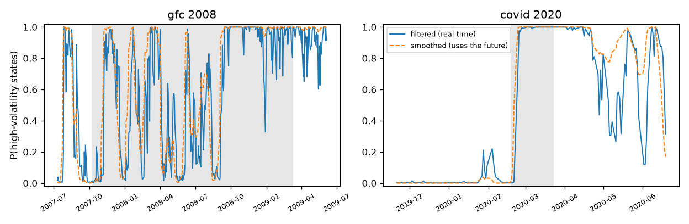
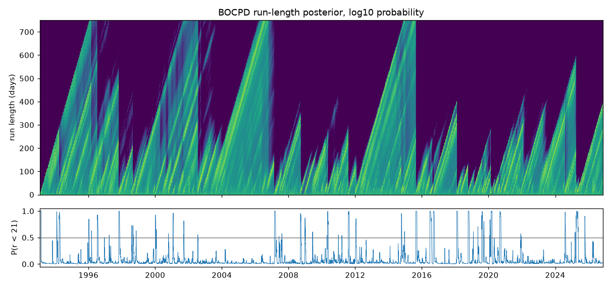

# Regime models

Generated by `regport regime report`; do not edit by hand.

## Set-up

- Gaussian HMM, K = 4 (BIC on 1993-02 to 2004-12, D-05), features spy_logret, baa10y_diff (set A).
- Refits: 285, every 21 trading days on an expanding window of at least 2520 days; first fit ends 2003-01-31.
- **Proxy:** before 1998-01-02 the SPY return feature is the Kenneth French daily market return (Mkt-RF + RF): 1243 days, 1993-02-02 to 1997-12-31. It feeds the regime models only, never a portfolio return.
- Label switches (Hungarian matching overruled the canonical order): 18, on 2003-05-02, 2003-06-03, 2003-07-02, 2003-09-02, 2003-10-01, 2003-12-01, 2007-06-05, 2007-07-05, 2007-08-03, 2007-12-03, 2008-01-03, 2008-02-04, 2008-04-04, 2008-05-05, 2008-08-04, 2009-08-04, 2009-12-02, 2010-01-04.
- BOCPD: hazard 1/500, Normal-Gamma prior (alpha0 2, beta0 0.000119); P(run length < 21) above 0.5 on 5.9% of OOS days.

## States at the last refit (equity-return emission only)

| state | equity_return_mean_annual | equity_volatility_annual | expected_duration_days | stationary_probability | share_of_oos_days_most_likely |
|---|---|---|---|---|---|
| 0 | 0.046 | 0.157 | 14.816 | 0.406 | 0.260 |
| 1 | -0.095 | 0.263 | 14.605 | 0.180 | 0.257 |
| 2 | 0.306 | 0.078 | 20.733 | 0.398 | 0.434 |
| 3 | -1.318 | 0.720 | 5.805 | 0.016 | 0.049 |

## Filtered vs smoothed (AC-H-09)

Stress probability: the total probability of the high-volatility states (states 1, 3 at the last refit, whose equity-return variance exceeds the stationary-weighted average). The table gives the first date it passes 50%, from 90 days before each window. Filtered and smoothed use the same (final) parameters, so the only difference is that the smoother also sees the data after each date. The walk-forward column is what the strategies actually used.

| window | filtered | smoothed | smoothed earlier by (days) | walk-forward filtered |
|---|---|---|---|---|
| gfc_2008 | 2007-07-27 | 2007-07-25 | 2 | 2007-07-27 |
| covid_2020 | 2020-02-24 | 2020-02-24 | 0 | 2020-01-27 |
| rates_2022 | 2021-11-29 | 2021-11-26 | 3 | 2021-11-29 |

