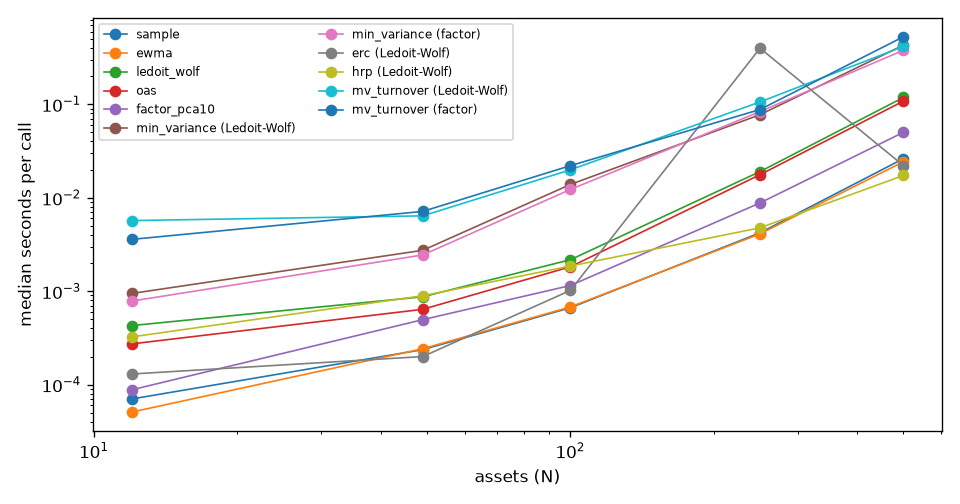

# Scaling to 500 assets

Generated by `regport bench scaling`; do not edit by hand. Timings are wall-clock medians on one machine and vary from run to run, so they are reported, not frozen.

- Hardware: Intel Core i9-14900K (24 cores, 32 threads), 128 GB RAM, Windows 11 Pro, Python 3.12; BLAS threads limited to 1 while live recorders run on the same PC (P-10).
- Data: synthetic 5-factor daily returns, 504-day window; plus the Kenneth French 49 industries where noted.

## Runtime and memory per call

| universe | stage | method | median_seconds | peak_mib |
|---|---|---|---|---|
| 12 | estimator | ewma | 0.0001 | 0.0975 |
| 49 industries | estimator | ewma | 0.0002 | 0.2551 |
| 49 | estimator | ewma | 0.0002 | 0.2560 |
| 100 | estimator | ewma | 0.0007 | 0.4730 |
| 250 | estimator | ewma | 0.0041 | 2.8911 |
| 500 | estimator | ewma | 0.0243 | 11.4990 |
| 12 | estimator | factor_pca10 | 0.0001 | 0.0939 |
| 49 | estimator | factor_pca10 | 0.0005 | 0.2527 |
| 49 industries | estimator | factor_pca10 | 0.0007 | 0.2518 |
| 100 | estimator | factor_pca10 | 0.0012 | 0.7011 |
| 250 | estimator | factor_pca10 | 0.0088 | 4.3243 |
| 500 | estimator | factor_pca10 | 0.0501 | 17.2295 |
| 12 | estimator | ledoit_wolf | 0.0004 | 0.0973 |
| 49 industries | estimator | ledoit_wolf | 0.0011 | 0.4167 |
| 49 | estimator | ledoit_wolf | 0.0009 | 0.4168 |
| 100 | estimator | ledoit_wolf | 0.0022 | 0.9257 |
| 250 | estimator | ledoit_wolf | 0.0190 | 2.8881 |
| 500 | estimator | ledoit_wolf | 0.1183 | 11.4959 |
| 12 | estimator | oas | 0.0003 | 0.0954 |
| 49 | estimator | oas | 0.0006 | 0.2542 |
| 49 industries | estimator | oas | 0.0011 | 0.2532 |
| 100 | estimator | oas | 0.0018 | 0.5460 |
| 250 | estimator | oas | 0.0176 | 2.8879 |
| 500 | estimator | oas | 0.1081 | 11.4958 |
| 12 | estimator | sample | 0.0001 | 0.0939 |
| 49 | estimator | sample | 0.0002 | 0.2527 |
| 49 industries | estimator | sample | 0.0002 | 0.2518 |
| 100 | estimator | sample | 0.0007 | 0.4691 |
| 250 | estimator | sample | 0.0042 | 2.8872 |
| 500 | estimator | sample | 0.0262 | 11.4951 |
| 12 | optimizer | erc (Ledoit-Wolf) | 0.0001 | 0.0096 |
| 49 industries | optimizer | erc (Ledoit-Wolf) | 0.0002 | 0.0755 |
| 49 | optimizer | erc (Ledoit-Wolf) | 0.0002 | 0.0755 |
| 100 | optimizer | erc (Ledoit-Wolf) | 0.0010 | 0.3090 |
| 250 | optimizer | erc (Ledoit-Wolf) | 0.3979 | 1.9158 |
| 500 | optimizer | erc (Ledoit-Wolf) | 0.0221 | 7.6455 |
| 12 | optimizer | hrp (Ledoit-Wolf) | 0.0003 | 0.0094 |
| 49 | optimizer | hrp (Ledoit-Wolf) | 0.0009 | 0.0757 |
| 49 industries | optimizer | hrp (Ledoit-Wolf) | 0.0009 | 0.0757 |
| 100 | optimizer | hrp (Ledoit-Wolf) | 0.0019 | 0.3075 |
| 250 | optimizer | hrp (Ledoit-Wolf) | 0.0048 | 1.9119 |
| 500 | optimizer | hrp (Ledoit-Wolf) | 0.0173 | 7.6378 |
| 12 | optimizer | min_variance (Ledoit-Wolf) | 0.0009 | 0.0144 |
| 49 | optimizer | min_variance (Ledoit-Wolf) | 0.0027 | 0.1161 |
| 49 industries | optimizer | min_variance (Ledoit-Wolf) | 0.0032 | 0.1161 |
| 100 | optimizer | min_variance (Ledoit-Wolf) | 0.0139 | 0.4691 |
| 250 | optimizer | min_variance (Ledoit-Wolf) | 0.0773 | 2.8872 |
| 500 | optimizer | min_variance (Ledoit-Wolf) | 0.4290 | 11.4951 |
| 12 | optimizer | min_variance (factor) | 0.0008 | 0.0142 |
| 49 | optimizer | min_variance (factor) | 0.0024 | 0.1161 |
| 49 industries | optimizer | min_variance (factor) | 0.0033 | 0.1161 |
| 100 | optimizer | min_variance (factor) | 0.0123 | 0.4691 |
| 250 | optimizer | min_variance (factor) | 0.0835 | 2.8872 |
| 500 | optimizer | min_variance (factor) | 0.3781 | 11.4951 |
| 12 | optimizer | mv_turnover (Ledoit-Wolf) | 0.0057 | 0.1313 |
| 49 | optimizer | mv_turnover (Ledoit-Wolf) | 0.0064 | 0.4197 |
| 49 industries | optimizer | mv_turnover (Ledoit-Wolf) | 0.0102 | 0.4196 |
| 100 | optimizer | mv_turnover (Ledoit-Wolf) | 0.0199 | 1.3608 |
| 250 | optimizer | mv_turnover (Ledoit-Wolf) | 0.1059 | 7.6406 |
| 500 | optimizer | mv_turnover (Ledoit-Wolf) | 0.4159 | 29.7409 |
| 12 | optimizer | mv_turnover (factor) | 0.0036 | 0.1301 |
| 49 | optimizer | mv_turnover (factor) | 0.0071 | 0.4196 |
| 49 industries | optimizer | mv_turnover (factor) | 0.0085 | 0.4201 |
| 100 | optimizer | mv_turnover (factor) | 0.0220 | 1.3612 |
| 250 | optimizer | mv_turnover (factor) | 0.0879 | 7.6400 |
| 500 | optimizer | mv_turnover (factor) | 0.5276 | 29.7415 |

## Conditioning (N/T)

| universe | n_assets | n_over_t | estimator | condition_number |
|---|---|---|---|---|
| 12 | 12 | 0.0 | factor_pca10 | 39.1 |
| 49 | 49 | 0.1 | factor_pca10 | 51.8 |
| 49 industries | 49 | 0.1 | factor_pca10 | 191.1 |
| 100 | 100 | 0.2 | factor_pca10 | 84.1 |
| 250 | 250 | 0.5 | factor_pca10 | 191.1 |
| 500 | 500 | 1.0 | factor_pca10 | 441.9 |
| 12 | 12 | 0.0 | ledoit_wolf | 6.9 |
| 49 | 49 | 0.1 | ledoit_wolf | 49.6 |
| 49 industries | 49 | 0.1 | ledoit_wolf | 180.0 |
| 100 | 100 | 0.2 | ledoit_wolf | 157.7 |
| 250 | 250 | 0.5 | ledoit_wolf | 911.6 |
| 500 | 500 | 1.0 | ledoit_wolf | 6210.7 |
| 12 | 12 | 0.0 | sample | 7.5 |
| 49 | 49 | 0.1 | sample | 55.2 |
| 49 industries | 49 | 0.1 | sample | 310.0 |
| 100 | 100 | 0.2 | sample | 191.2 |
| 250 | 250 | 0.5 | sample | 1511.8 |
| 500 | 500 | 1.0 | sample | 19791541.8 |

## HRP vs min-variance out of sample, 49 industries

From the Kenneth French robustness runs (`reports/robustness.md`).

| optimizer | regime | annual_volatility | sharpe | max_drawdown |
|---|---|---|---|---|
| min_variance | none | 0.1225 | 0.5293 | -0.4363 |
| min_variance | hmm_A | 0.1260 | 0.5110 | -0.4187 |
| hrp | none | 0.1523 | 0.5367 | -0.5133 |
| hrp | hmm_A | 0.1551 | 0.5397 | -0.5286 |

