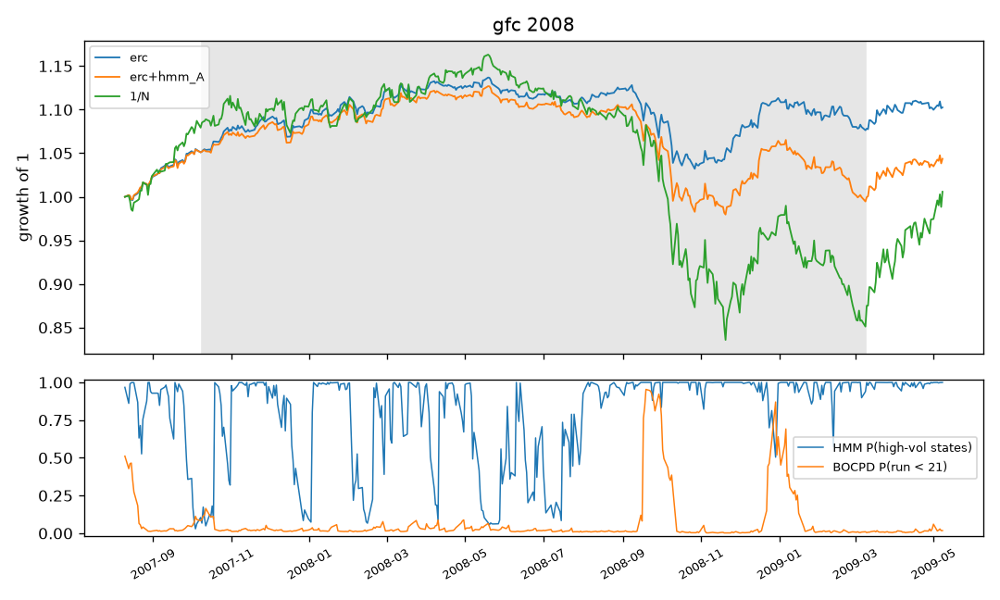
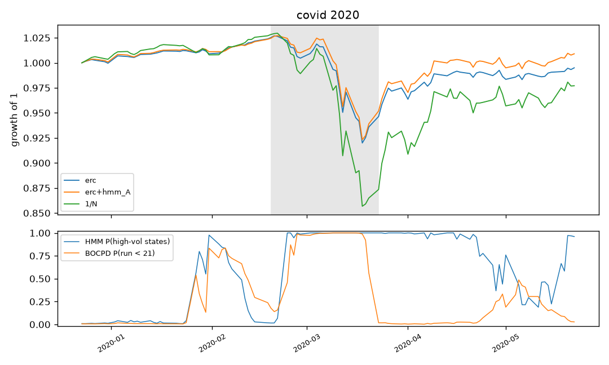
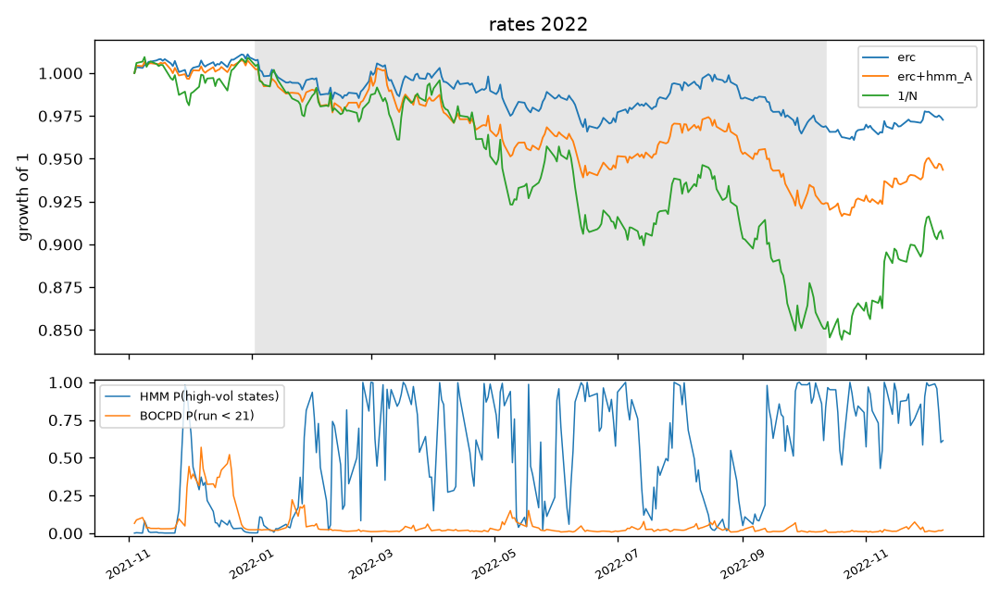

# Stress tests

Generated by `regport stress`; do not edit by hand.

Windows are fixed in the config and were never tuned. Drawdowns are measured against the high-water mark entering each window; recovery counts trading days from the trough until the peak level is regained.

## gfc 2008 (2007-10-09 to 2009-03-09)

| strategy | window_return | max_drawdown | peak | trough | days_to_trough | recovery | worst_5d_return | realized_vol |
|---|---|---|---|---|---|---|---|---|
| min_variance | 0.060 | -0.056 | 2008-09-08 | 2008-10-10 | 24 | 49 days (2008-12-19) | -0.038 | 0.057 |
| min_variance+bocpd | 0.047 | -0.058 | 2008-09-08 | 2008-10-10 | 24 | 114 days (2009-03-26) | -0.040 | 0.057 |
| min_variance+hmm_B | 0.035 | -0.081 | 2008-09-08 | 2008-10-10 | 24 | 274 days (2009-11-11) | -0.045 | 0.066 |
| hrp+hmm_B | 0.046 | -0.084 | 2008-09-08 | 2008-10-10 | 24 | 48 days (2008-12-18) | -0.048 | 0.079 |
| hrp+hmm_A | 0.018 | -0.089 | 2008-03-12 | 2008-10-10 | 148 | 275 days (2009-11-12) | -0.045 | 0.074 |
| erc+bocpd | 0.022 | -0.090 | 2008-05-19 | 2008-10-27 | 112 | 259 days (2009-11-05) | -0.041 | 0.067 |
| min_variance+hmm_A | 0.013 | -0.090 | 2008-05-19 | 2008-10-10 | 101 | 319 days (2010-01-19) | -0.047 | 0.068 |
| hrp | 0.038 | -0.091 | 2008-03-12 | 2008-10-31 | 163 | 33 days (2008-12-18) | -0.057 | 0.084 |
| erc | 0.024 | -0.092 | 2008-05-19 | 2008-10-27 | 112 | 259 days (2009-11-05) | -0.042 | 0.068 |
| hrp+bocpd | 0.052 | -0.094 | 2008-03-12 | 2008-10-13 | 149 | 47 days (2008-12-18) | -0.057 | 0.085 |
| mv_turnover+hmm_B | 0.237 | -0.111 | 2008-05-21 | 2008-07-25 | 45 | 83 days (2008-11-20) | -0.060 | 0.135 |
| erc+hmm_B | -0.010 | -0.117 | 2008-05-19 | 2008-10-27 | 112 | 247 days (2009-10-20) | -0.054 | 0.074 |
| erc+hmm_A | -0.054 | -0.131 | 2008-05-19 | 2008-11-20 | 130 | 319 days (2010-03-02) | -0.057 | 0.077 |
| mv_turnover | 0.038 | -0.150 | 2008-07-14 | 2008-10-30 | 77 | 384 days (2010-05-12) | -0.059 | 0.134 |
| mv_turnover+bocpd | 0.032 | -0.163 | 2008-07-14 | 2008-11-03 | 79 | 463 days (2010-09-07) | -0.059 | 0.135 |
| mv_turnover+hmm_A | 0.029 | -0.225 | 2008-07-14 | 2008-11-12 | 86 | 498 days (2010-11-04) | -0.052 | 0.132 |
| 1/N | -0.211 | -0.281 | 2008-05-19 | 2008-11-20 | 130 | 248 days (2009-11-16) | -0.089 | 0.172 |

## covid 2020 (2020-02-19 to 2020-03-23)

| strategy | window_return | max_drawdown | peak | trough | days_to_trough | recovery | worst_5d_return | realized_vol |
|---|---|---|---|---|---|---|---|---|
| hrp+bocpd | -0.015 | -0.057 | 2020-02-20 | 2020-03-18 | 19 | 16 days (2020-04-09) | -0.040 | 0.154 |
| min_variance+bocpd | -0.020 | -0.068 | 2020-02-20 | 2020-03-18 | 19 | 414 days (2021-11-05) | -0.044 | 0.155 |
| min_variance | -0.042 | -0.070 | 2020-02-20 | 2020-03-18 | 19 | 934 days (2023-12-01) | -0.045 | 0.149 |
| hrp | -0.044 | -0.075 | 2020-02-20 | 2020-03-18 | 19 | 325 days (2021-07-01) | -0.047 | 0.154 |
| min_variance+hmm_A | -0.044 | -0.079 | 2020-03-04 | 2020-03-18 | 10 | 311 days (2021-06-11) | -0.054 | 0.157 |
| min_variance+hmm_B | -0.053 | -0.082 | 2020-03-04 | 2020-03-18 | 10 | 931 days (2023-11-28) | -0.056 | 0.159 |
| erc+hmm_A | -0.070 | -0.101 | 2020-02-21 | 2020-03-18 | 18 | 74 days (2020-07-02) | -0.065 | 0.189 |
| erc+bocpd | -0.060 | -0.102 | 2020-02-21 | 2020-03-18 | 18 | 86 days (2020-07-21) | -0.061 | 0.184 |
| hrp+hmm_A | -0.061 | -0.104 | 2020-03-06 | 2020-03-19 | 9 | 93 days (2020-07-31) | -0.067 | 0.199 |
| erc | -0.076 | -0.104 | 2020-02-20 | 2020-03-18 | 19 | 308 days (2021-06-08) | -0.065 | 0.191 |
| hrp+hmm_B | -0.073 | -0.106 | 2020-03-04 | 2020-03-19 | 11 | 364 days (2021-08-27) | -0.069 | 0.199 |
| erc+hmm_B | -0.083 | -0.110 | 2020-02-21 | 2020-03-18 | 18 | 91 days (2020-07-28) | -0.070 | 0.204 |
| mv_turnover+bocpd | -0.028 | -0.151 | 2020-03-09 | 2020-03-19 | 8 | 395 days (2021-10-12) | -0.089 | 0.367 |
| mv_turnover | -0.039 | -0.155 | 2020-03-09 | 2020-03-19 | 8 | 395 days (2021-10-12) | -0.091 | 0.373 |
| mv_turnover+hmm_A | -0.062 | -0.162 | 2020-03-06 | 2020-03-18 | 8 | 56 days (2020-06-08) | -0.112 | 0.294 |
| 1/N | -0.149 | -0.168 | 2020-02-21 | 2020-03-18 | 18 | 75 days (2020-07-06) | -0.101 | 0.298 |
| mv_turnover+hmm_B | -0.127 | -0.236 | 2018-01-26 | 2020-03-18 | 538 | 1130 days (2024-09-13) | -0.124 | 0.347 |

## rates 2022 (2022-01-03 to 2022-10-12)

| strategy | window_return | max_drawdown | peak | trough | days_to_trough | recovery | worst_5d_return | realized_vol |
|---|---|---|---|---|---|---|---|---|
| hrp+bocpd | -0.007 | -0.030 | 2021-12-30 | 2022-02-10 | 29 | 127 days (2022-08-15) | -0.016 | 0.047 |
| hrp | -0.007 | -0.030 | 2021-12-30 | 2022-02-10 | 29 | 127 days (2022-08-15) | -0.016 | 0.047 |
| erc | -0.040 | -0.046 | 2021-12-30 | 2022-09-30 | 189 | 293 days (2023-11-30) | -0.019 | 0.050 |
| erc+bocpd | -0.040 | -0.046 | 2021-12-30 | 2022-09-30 | 189 | 293 days (2023-11-30) | -0.019 | 0.050 |
| min_variance+bocpd | -0.043 | -0.050 | 2021-12-28 | 2022-09-30 | 191 | 288 days (2023-11-22) | -0.020 | 0.044 |
| min_variance+hmm_B | -0.042 | -0.051 | 2020-03-04 | 2022-06-16 | 577 | 364 days (2023-11-28) | -0.017 | 0.048 |
| min_variance | -0.043 | -0.054 | 2020-02-20 | 2022-09-30 | 659 | 294 days (2023-12-01) | -0.020 | 0.044 |
| min_variance+hmm_A | -0.042 | -0.055 | 2022-03-07 | 2022-06-14 | 69 | 378 days (2023-12-14) | -0.021 | 0.051 |
| hrp+hmm_B | -0.052 | -0.059 | 2021-12-30 | 2022-06-14 | 114 | 369 days (2023-12-01) | -0.022 | 0.054 |
| hrp+hmm_A | -0.059 | -0.067 | 2022-03-08 | 2022-09-30 | 143 | 306 days (2023-12-19) | -0.023 | 0.058 |
| erc+hmm_B | -0.080 | -0.085 | 2021-12-30 | 2022-09-30 | 189 | 355 days (2024-03-01) | -0.029 | 0.062 |
| erc+hmm_A | -0.081 | -0.086 | 2021-12-27 | 2022-09-30 | 192 | 335 days (2024-02-01) | -0.026 | 0.062 |
| mv_turnover+bocpd | 0.023 | -0.089 | 2022-04-20 | 2022-09-30 | 113 | 374 days (2024-03-28) | -0.062 | 0.126 |
| mv_turnover | 0.023 | -0.089 | 2022-04-20 | 2022-09-30 | 113 | 374 days (2024-03-28) | -0.062 | 0.126 |
| mv_turnover+hmm_B | -0.071 | -0.130 | 2018-01-26 | 2022-02-23 | 1026 | 642 days (2024-09-13) | -0.042 | 0.116 |
| 1/N | -0.156 | -0.158 | 2021-11-09 | 2022-09-27 | 221 | 410 days (2024-05-15) | -0.051 | 0.103 |
| mv_turnover+hmm_A | -0.150 | -0.226 | 2021-11-24 | 2022-09-30 | 213 | 676 days (2025-06-12) | -0.071 | 0.134 |

